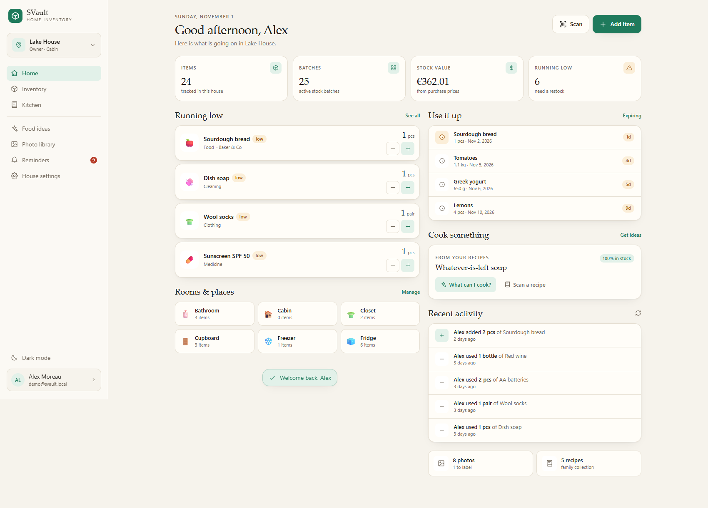
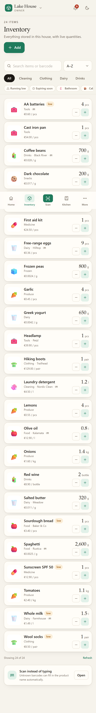
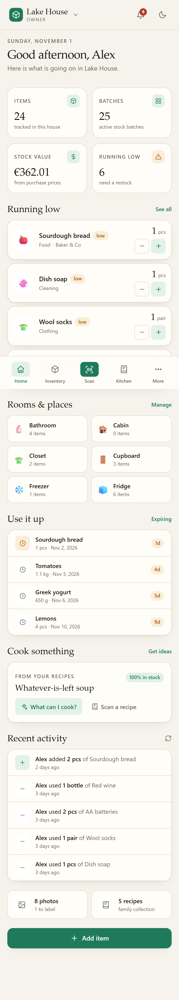
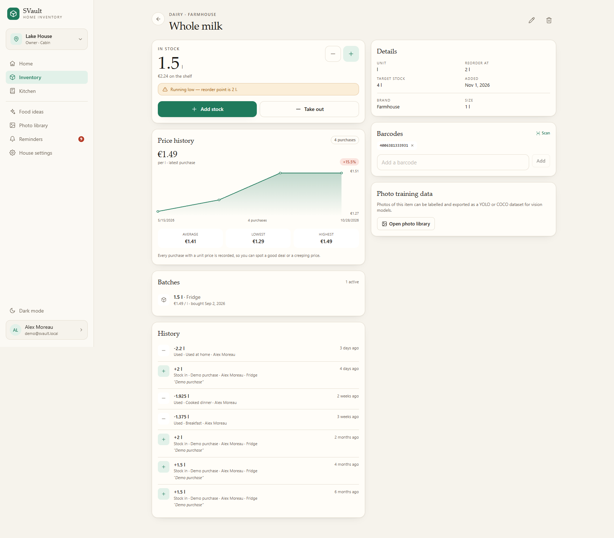
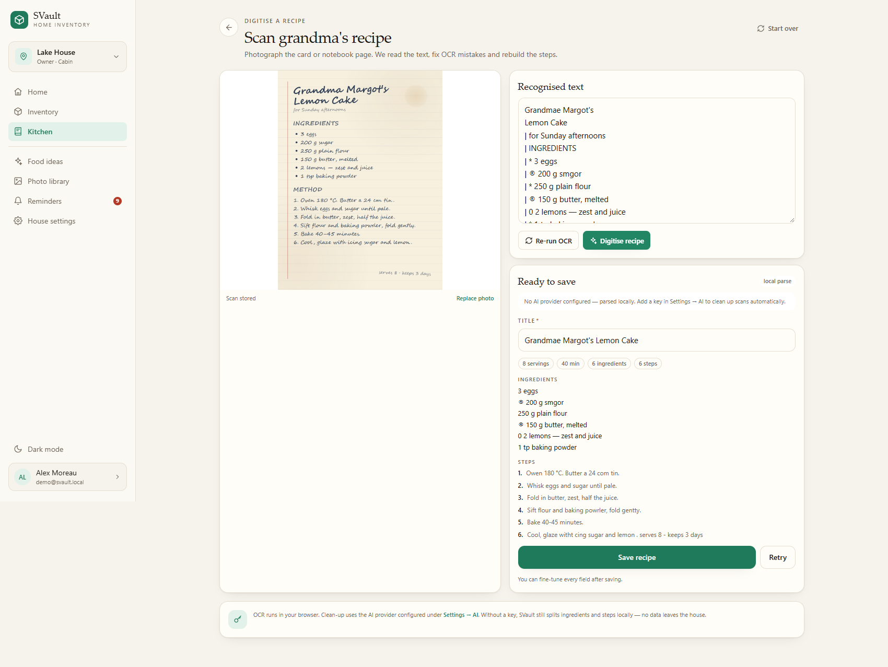
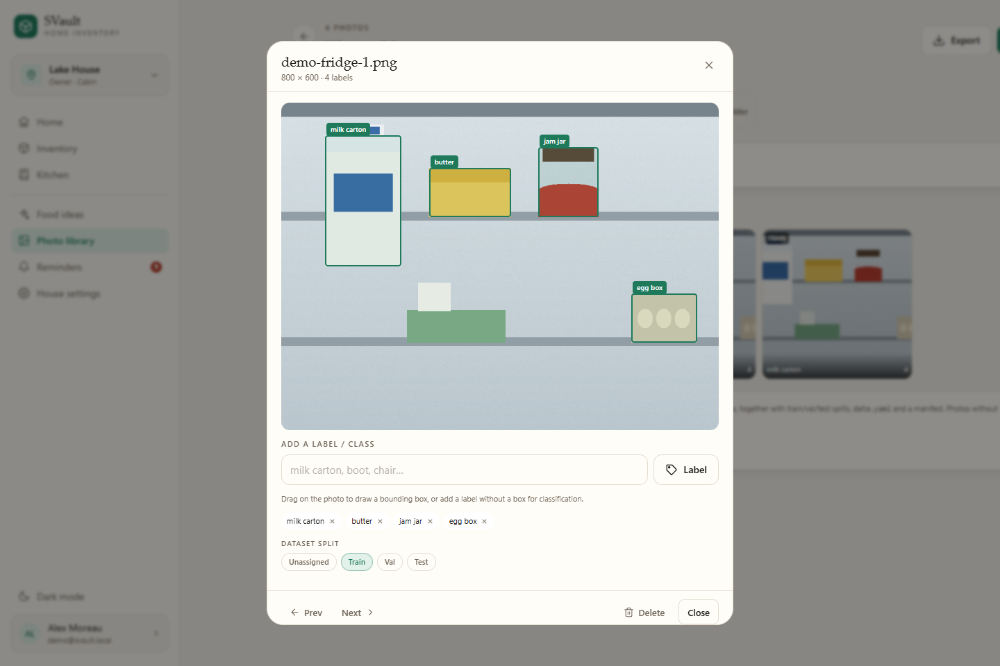
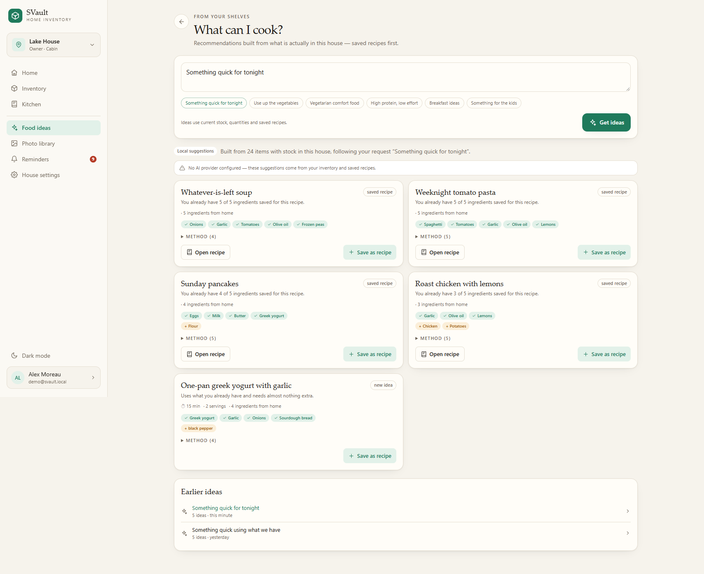
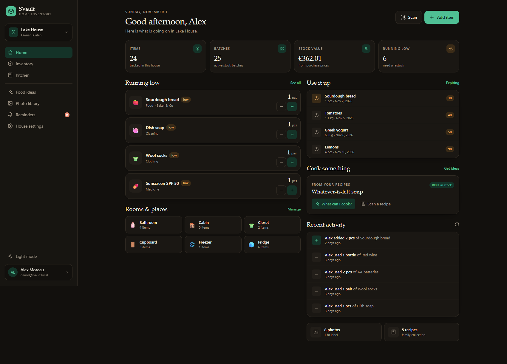

# SVault

**A self-hosted, mobile-first vault for everything you own — house by house.**

Track what is in the fridge, the cabin and the closet. Scan barcodes, watch prices, digitise your
grandma's recipes, get dinner ideas from your actual shelves, and label photos into a vision-model
dataset — all from one PWA that runs in a single Docker container.



## What it does

| | |
|---|---|
| **Several houses, several people** | Every house has its own stock, places, categories, recipes and photos. Invite family with owner/admin/member/viewer roles. |
| **Dynamic inventory** | Items get whatever attributes *you* define per house (brand, size, flavour, material, warranty date…). Units are handled properly (g/kg, ml/l, pcs, pairs…). |
| **Stock that adds up** | Every change is a movement. Batches keep purchase price, location and expiry, so stock counts, value and FIFO consumption stay honest. |
| **Price history that means something** | Record a unit price on every purchase and see per-unit trends, averages and highs/lows. Prices are normalised when units differ (e.g. 500 ml at €0.80 becomes €1.60/l). |
| **Barcode scanning** | Camera scan (ZXing) works in the browser; unknown EAN/UPC codes fall back to an OpenFoodFacts lookup and pre-fill a new item. |
| **Low stock & expiry reminders** | Set a reorder point, get a reminder when it is reached. Expiring batches warn you days ahead. Checked on every stock change plus every 30 minutes. |
| **Recipes, digitised** | Photograph a handwritten card: OCR runs on-device (Tesseract, no upload), then AI or a local parser rebuilds the ingredients and steps. "Improve with AI" fills gaps and rewrites steps. |
| **Cook what you have** | Meal suggestions built from current stock and saved recipes, with realistic missing-ingredient lists — AI or fully local. |
| **Vision datasets** | Upload photos into folders, draw boxes, name labels, assign train/val/test splits, and export a ready-to-train YOLO or COCO zip (classes, `data.yaml`, manifest included). |
| **Installable & offline-ish** | Real PWA with manifest and service worker; app shell is cached, API always hits the server. |

<table>
<tr>
<td></td>
<td></td>
<td></td>
</tr>
</table>

### A closer look

<table>
<tr>
<td><br><sub>OCR + AI recipe digitisation (works offline with the local parser too)</sub></td>
<td><br><sub>Bounding boxes, classes and train/val/test splits</sub></td>
</tr>
<tr>
<td><br><sub>Meal ideas from current stock and saved recipes</sub></td>
<td><br><sub>Dark mode, also on mobile</sub></td>
</tr>
</table>

## Quick start (Docker)

```bash
docker compose up -d --build
```

Open **http://localhost:8080** and create your first account. Houses, places and categories get
sensible defaults automatically.

Want a populated vault to explore? Set `SEED_DEMO=true` in `.env` **before the first start** (or run
`npm run seed` locally). Demo login:

```
demo@svault.local / demo1234
sofia@svault.local / demo1234   (member of the same house)
```

Data lives in the `svault-data` volume (`/data` inside the container): one SQLite database plus
uploads. Back up that volume and you have backed up everything. Set `SVAULT_PORT` if `8080` is
already taken by another service on your machine.

### Access from your phone (same Wi-Fi)

1. Find the PC's LAN IP (`ipconfig`, e.g. `192.168.0.148`).
2. Open `http://<pc-ip>:<SVAULT_PORT>` on the phone.
3. Allow inbound TCP on that port in Windows Firewall, for example in an elevated PowerShell:
   ```powershell
   New-NetFirewallRule -DisplayName "SVault (TCP 8095)" -Direction Inbound -Protocol TCP `
     -LocalPort 8095 -Action Allow -Profile Any
   ```
4. Give the PC a DHCP reservation in your router so the address survives reboots, and make sure
   Docker Desktop starts when you log in (Settings → General).

Browsers only expose the camera on secure origins, so barcode scanning works over `localhost` or
**HTTPS**. On a plain-HTTP LAN address everything else works, but the scanner will ask you to type
the code. Use a TLS reverse proxy (Caddy/Traefik with a trusted or locally trusted certificate) or
Tailscale Serve if you want one-tap scanning from the phone.

### Camera on a phone

Browsers only allow `getUserMedia` on **HTTPS** or `localhost`. To scan barcodes from your phone,
serve SVault through a reverse proxy with TLS (Caddy, Traefik, npm, Tailscale Serve…) and set
`COOKIE_SECURE=true`. Everything else works over plain HTTP on your LAN.

## Local development

```bash
npm install
npm run dev        # API on :4000, Vite on :5173
npm run seed       # optional demo data
```

- Web: http://localhost:5173 (proxies `/api` and `/uploads` to :4000)
- API: http://localhost:4000/api/health

Production build:

```bash
npm run build      # client -> dist/client, server -> dist/server
npm start          # serves both from :4000
npm test           # 42 API, parser, AI-mock and dataset tests
npm run typecheck
```

Requires **Node 22+**. No native modules: SQLite comes from `node:sqlite`, which keeps the Docker
image small and the install painless.

## Configuration

Copy `.env.example` to `.env` (Docker Compose reads it) or export the variables yourself.

| Variable | Default | Purpose |
|---|---|---|
| `PORT` | `4000` | API / web port inside the container |
| `DATA_DIR` | `./data` (`/data` in Docker) | SQLite database and uploads |
| `COOKIE_SECURE` | `true` in production | Set `false` for plain-HTTP LAN installs |
| `SEED_DEMO` | `false` | Load demo data when the database is empty (Docker entrypoint) |
| `OPENAI_API_KEY` | — | Optional AI key shared by all houses |
| `OPENAI_BASE_URL` | `https://api.openai.com/v1` | Any OpenAI-compatible endpoint (Ollama, LM Studio, OpenRouter…) |
| `OPENAI_MODEL` | `gpt-4o-mini` | Text model for recipes/ideas |
| `OPENAI_VISION_MODEL` | falls back to text model | Vision model used to read recipe photos |
| `MAX_UPLOAD_MB` | `20` | Per-image upload limit |

AI can also be configured **per house** in *Settings → AI*. A stored key wins over the environment.
Without a key everything still works: OCR is local, recipe parsing is heuristic and food ideas come
from your own inventory and saved recipes. The UI tells you which path was used.

### Connecting AI (2 minutes)

1. Open **Settings → AI** (as owner/admin of the house).
2. Pick a preset or fill the fields, press **Save AI settings**, then **Test saved connection**.

| Provider | Base URL | Text model | Vision model | Key |
|---|---|---|---|---|
| OpenAI | `https://api.openai.com/v1` | `gpt-4o-mini` | `gpt-4o-mini` | your key |
| OpenRouter | `https://openrouter.ai/api/v1` | `openai/gpt-4o-mini` | `openai/gpt-4o-mini` | your key |
| Ollama (local) | `http://host.docker.internal:11434/v1` | `llama3.2` | `qwen2.5vl:7b` (optional) | any placeholder |
| LM Studio (local) | `http://host.docker.internal:1234/v1` | the loaded model id | leave empty | any placeholder |

For a fully local setup:

```bash
ollama pull llama3.2
# optional, only for reading photos without OCR:
ollama pull qwen2.5vl:7b
```

Then choose **Ollama (local)** in Settings → AI, press Save and Test. SVault only sends the scan image
when a vision model is configured; otherwise it relies on the on-device OCR text, which is what most
local text models expect. On Linux hosts replace `host.docker.internal` with your Docker gateway
(`172.17.0.1`) or the service name if Ollama runs in Compose.

What AI actually powers:

- **Recipe scan cleanup** — fixes OCR errors and structures ingredients/steps.
- **Improve recipe** — fills missing quantities, times and temperatures; notes what changed.
- **Food ideas** — suggestions from current stock and saved recipes, with missing essentials.

Stock, barcodes, price history, reminders and photo labelling never call AI.

## How the pieces work

### Stock, batches and prices

- Each item has a **base unit** (`g`, `l`, `pcs`…). Quantities and prices are normalised to it.
- Adding stock creates a **batch** with quantity, location, purchase date, expiry and unit price.
- Removing stock consumes **FIFO** (soonest expiry, then oldest purchase), so expired food goes first.
- "Count" sets an absolute quantity and records the difference as an adjustment.
- Moves transfer batches between places without changing the total.
- Every movement stores the balance after the change, so history reads like a ledger.
- Price history is derived from purchase movements; a 500 ml purchase for €0.80 shows as €1.60/l.

### Barcodes

- Codes are unique per house. The item page can hold several barcodes.
- Scanning first checks your house, then (for unknown codes) queries OpenFoodFacts with a short
  timeout. Offline? You still get "create item" with the code attached.
- The scanner uses the rear camera via `@zxing/browser`, with a manual code entry fallback.

### Recipes: OCR + AI

1. The photo is compressed in the browser and uploaded as the recipe's source image.
2. Tesseract OCR runs **in the browser** using assets served from `/tesseract` (vendored at build
   time, ~12 MB, cached by the service worker). Text is editable before continuing.
3. `POST /recipes/scan` cleans the text:
   - with an AI provider: JSON-structured ingredients/steps, OCR fixes, inferences noted;
   - without one: a tolerant local parser (sections, quantities, fractions, timers, titles).
4. Save, then edit anything, or press **Improve with AI** to fill missing quantities/timings.
5. Ingredient availability is matched loosely against stock ("eggs" ↔ "Free-range eggs").

### Food ideas

The prompt + current stock + saved recipes go to the AI (or the local matcher). Local suggestions
rank saved recipes by ingredient coverage, then add practical inventory-only ideas. Saving an idea
turns it into a normal recipe you can edit.

### Photo library and vision datasets

- Photos live in **folders** (collections) per house.
- Drag on a photo to draw a bounding box and name it; labels without a box work as classification tags.
- Every photo has a split (`train` / `val` / `test` / `unassigned`).
- Export produces a zip with:
  - `images/<split>/…` and `labels/<split>/…` (normalised YOLO boxes)
  - `classes.txt`, `data.yaml`, `manifest.csv`
  - `annotations.coco.json` (absolute COCO boxes + categories)
- Photos without boxes still export as classification samples (`manifest.csv`).

### Reminders

- Low-stock: fires when quantity ≤ reorder point, re-opens automatically if it happens again, and
  resolves itself when restocked. Disable per house in *Settings → Reminders*.
- Expiry: warns `expiryDays` ahead (default 7) for every batch with quantity left.
- Delivery: in-app bell + optional browser notifications. (No external push service — nothing leaves
  your server.)

## API sketch

All endpoints are JSON (except uploads/export) and cookie-authenticated.

```
POST /api/auth/register|login|logout         GET/PATCH /api/auth/me
GET  /api/houses                             POST /api/houses
GET  /api/houses/:id                         PATCH/DELETE /api/houses/:id
GET  /api/houses/:id/dashboard
GET  /api/houses/:id/items?q=&categoryId=&locationId=&low=1&expiring=1
POST /api/houses/:id/items                   POST /api/houses/:id/scan?code=
GET  /api/items/:id                          PATCH/DELETE /api/items/:id
POST /api/items/:id/stock                    (add | remove | waste | set | move)
GET  /api/items/:id/movements
GET  /api/houses/:id/recipes                 POST /api/houses/:id/recipes
POST /api/houses/:id/recipes/scan            POST /api/houses/:id/recipes/upload
POST /api/recipes/:id/ai
GET  /api/houses/:id/ideas                   POST /api/houses/:id/ideas
GET  /api/houses/:id/photos                  POST /api/houses/:id/photos
POST /api/photos/:id/labels                  PUT  /api/photos/:id/labels
GET  /api/houses/:id/photos/export?format=yolo|coco
GET  /api/houses/:id/notifications           POST /api/houses/:id/notifications/scan
```

## Screens

- **Home** – stock summary, running low, expiring, recent activity, cooking shortcuts.
- **Inventory** – search, category/location/low-stock/expiry filters, inline ±1, sort by value.
- **Item** – batch list with expiry, price chart, movement history, barcodes, dynamic attributes.
- **Scan** – camera + manual entry, quick ±1, create-from-barcode.
- **Kitchen** – recipes with stock coverage, full recipe view, scan, favourites.
- **Ideas** – prompt chips, AI/local meal cards, save as recipe.
- **Photo library** – folders, upload, box labelling, splits, dataset export.
- **Reminders** – low stock & expiry, browser notification opt-in.
- **Settings** – general, places, categories, attributes, members/invites, AI, reminders, data export.
- **More/Profile** – theme, install, account, password.

Dark mode follows the system and can be toggled in the sidebar/more menu.

## Project layout

```
client/        React 19 + Vite + Tailwind v4 PWA
  components/  UI primitives, shell, scanner, charts, photo labeller
  pages/       one file per screen
server/        Express 5 + node:sqlite API
  routes/      auth, houses, inventory, recipes, ideas, photos, notifications
  services/    stock math, reminders, recipe parsing, house defaults
  lib/png.ts   tiny PNG encoder used by the demo seeder
shared/        domain types shared by client and server
public/        manifest, service worker, icons, vendored OCR assets (generated)
scripts/       OCR vendoring, icon/recipe-card generation, smoke + visual checks
```

## Testing

```bash
npm test                     # API integration + parser + unit tests (temp DB per run)
node scripts/smoke.mjs URL   # black-box smoke test against a running server
node scripts/visual-check.mjs URL   # Playwright screenshots + console/API error scan
node scripts/functional-check.mjs URL  # click-through UI checks on a throwaway copy
```

The browser scripts need `npm i --no-save playwright-core` and a local Edge/Chrome install
(the paths are set at the top of each script).

The test suite covers unit conversion, OCR-noise parsing, auth, per-house isolation, membership
roles, item creation, barcode conflicts and lookup, FIFO consumption, absolute counts, moves, low
stock reminders, recipe matching, local idea generation, photo export and SPA routing.

## Operational notes & limitations

- **Single node by design.** SQLite in WAL mode + a local uploads folder. Great for a home server;
  not a clustered deployment.
- **Invites are links.** There is no email sending (nothing to configure, nothing to leak). Create
  an invite, copy the link and share it. Expired/revoked links stop working.
- **No password-reset email.** If you lose the password, use the API/DB directly (or re-seed on a
  fresh volume).
- **AI keys are stored in the house settings table** (plaintext) because the app is self-hosted and
  single-tenant. Prefer the environment variable if you prefer keys outside the DB.
- **Browser camera requires HTTPS** (or localhost). HEIC photos display if the browser supports
  decoding them; uploads are stored unchanged.
- **Uploads are served from `/uploads` without auth.** Filenames are random; still, treat the URL
  as the secret or put the whole app behind your reverse proxy.
- The demo seeder adds fictional content only when the database has no demo user.

Built with TypeScript, Express, React, Tailwind and `node:sqlite` — no external services required.
