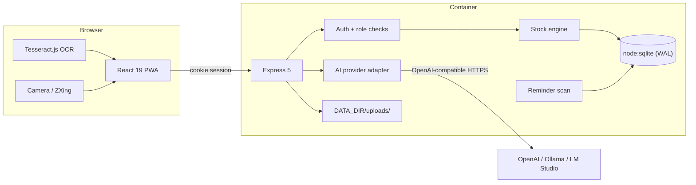

# Architecture

SVault is deliberately small: one Node.js process serves both the JSON API and the built React app,
and one SQLite file plus an uploads folder hold every byte of user data. There is no queue, no
separate database, no object store and no cloud dependency.

## Runtime

- **Node.js 22+** with native ESM. `node:sqlite` provides SQLite without a native addon, which keeps
  the Docker image small and the install free of build tooling. The container starts Node with
  `--disable-warning=ExperimentalWarning` because the SQLite module is still marked experimental.
- **Express 5** handles routing, JSON parsing, uploads (multer) and static files.
- **React 19 + Vite 8 + Tailwind CSS 4** build the client into `dist/client`.
- **TypeScript** is used end to end; server output goes to `dist/server`.

In production the same Express process serves `dist/client` with an SPA fallback, so there is nothing
else to deploy. In development Vite runs on port 5173 and proxies `/api` and `/uploads` to the API on
port 4000.

Startup order:

1. Resolve directories and create `DATA_DIR`, `uploads/`, `uploads/photos`, `uploads/items` and
   `uploads/recipes`.
2. Open SQLite and run the idempotent schema (`CREATE TABLE IF NOT EXISTS`) plus `PRAGMA
   journal_mode=WAL`, `foreign_keys=ON`, `busy_timeout=5000`.
3. Attach security headers and request logging (development only).
4. Mount the API routers.
5. Serve uploads and the built client, with `GET` fallback to `index.html` for client routes.
6. Listen on `0.0.0.0:PORT`, run a reminder scan, then repeat every 30 minutes.
7. On `SIGINT`/`SIGTERM`, stop accepting connections, close the database and exit.

## Request lifecycle

1. `attachUser` reads the `sv_session` cookie, hashes the token and joins `sessions` to `users`.
   Expired sessions are deleted on sight.
2. The router calls `requireAuth`, then `requireHouse(req, minRole)`.
3. `requireHouse` resolves membership from `house_members` and compares the role rank
   (`viewer < member < admin < owner`). A non-member gets `404` rather than `403` so house existence
   is not leaked.
4. Body validation uses Zod. Invalid bodies return `400` with a flattened error object.
5. Handlers use synchronous database calls inside transactions where consistency matters. Express 5
   forwards rejected promises to the central error handler.
6. Errors are normalised to `{ "error": "message", "details": ... }`. Unknown routes return JSON
   `404`; unexpected exceptions return a generic `500` and are logged.

## Authentication and sessions

- Passwords are hashed with `scrypt` (16-byte random salt, 64-byte hash) and stored as
  `s1$salt$hash`.
- A login creates a 24-byte random token. Only its SHA-256 hash is stored in `sessions`, so a database
  leak does not expose live sessions.
- The cookie is `HttpOnly`, `SameSite=Lax`, `Path=/`, valid for 30 days, and `Secure` in production
  unless `COOKIE_SECURE=false`. The app is same-origin and uses JSON requests, which together with
  `SameSite=Lax` avoids a separate CSRF token.
- There is no bearer token or API key authentication. The API is designed for the bundled web client.
- Users have an optional-but-backfilled `username` alongside `email`; both are case-insensitive and
  either can be used to sign in. Accounts created before usernames existed get one derived from the
  email local part on the next start.
- The first registered user is marked `is_admin`; house roles are independent of that flag.

## Data model

All identifiers are prefixed strings (`usr_`, `hse_`, `itm_`, `mov_`...), which makes logs and
exports readable. Timestamps are ISO-8601 strings; dates (`expires_at`, `purchased_at`) are
`YYYY-MM-DD`.

| Area | Tables |
| --- | --- |
| Identity | `users`, `sessions` |
| Tenancy | `houses`, `house_members`, `house_invites` |
| Taxonomy | `locations`, `categories`, `attribute_defs` |
| Inventory | `items`, `item_barcodes`, `stock_lots`, `stock_movements` |
| Purchases | `vendors`, `receipts`, `receipt_lines` |
| Purchase learning | `product_aliases` (raw shop name → item, per vendor) |
| Receipt layouts | `receipt_templates` (custom rules; built-in Lidl and Sklavenitis live in code) |
| Reference data | `vendor_catalog` (seeded shops by country) |
| Reminders | `notifications` |
| Cooking | `recipes`, `recipe_ingredients`, `food_ideas` |
| Vision | `photo_collections`, `photos`, `photo_labels` |
| AI | `ai_cache` (reserved; not currently used) |

Key constraints:

- Every house-owned table has `house_id` with `ON DELETE CASCADE`. Deleting a house removes its rows;
  uploaded files are intentionally left on disk.
- Barcodes are unique per house: `UNIQUE (house_id, code)`.
- Notification dedupe is `UNIQUE (house_id, dedupe_key)`, which makes reminder creation idempotent.
- Recipe ingredient links use `ON DELETE SET NULL`, so deleting an item does not delete the recipe.
- `houses.settings` is a JSON blob for AI, notification and unit preferences. It avoids schema churn
  for per-house options.

## Stock engine

`server/services/stock.ts` is the only place that mutates stock. Routes never write `stock_lots` or
`stock_movements` directly.

- **Add** creates a lot, converts the entered quantity to the item's base unit, normalises the price
  and records an `in` movement. Optional `vendorId` and `receiptId` stay on both the lot and movement
  as provenance.
- **Remove/waste** reads positive lots ordered by soonest expiry (nulls last), then oldest creation,
  and consumes them until the requested quantity is met. An optional `locationId` or `lotId` scopes
  the operation. The movement records the total delta and the resulting balance.
- **Set** computes the difference from the current total. Positive differences create a lot; negative
  differences consume FIFO. The movement type is `adjust`.
- **Move** removes from one place and creates/updates a lot in another without changing the total.
- Every mutation runs in a transaction. `tx()` uses `BEGIN` at the top level and `SAVEPOINT` for nested
  calls, so a multi-step recipe/AI save can compose safely.
- `afterStockChange()` re-evaluates low-stock and expiry reminders for the item/house.

Prices are normalised with `pricePerUnit(price, enteredUnit, baseUnit)`. Incompatible units are
rejected rather than approximated; see `server/units.ts` for the conversion tables. Item price history
is built from incoming movements and carries the shop and receipt, so the client can compare all shops
or a single one. Receipt analytics aggregate the receipt header (total, net, tax, VAT breakdown) and
receipt lines by vendor, month and item category.

## Reminders

`server/services/notifications.ts` derives reminders from current state instead of storing a schedule:

- Low stock: `quantity <= reorder_point` and `reorder_point > 0`, unless disabled in house settings.
  The dedupe key is `low:<itemId>`. Existing unresolved notifications keep their read state; a
  resolved one is reopened when the condition returns.
- Expiry: active lots with `expires_at <= today + expiryDays`. The dedupe key is `exp:<lotId>`.
  Notifications for lots that are gone or no longer in the window are resolved.
- The scan runs at boot and every 30 minutes, and is also triggered by the notifications scan endpoint.
- Read state is per user (`read_by` JSON array), so one person reading a reminder does not hide it from
  everyone else.
- Notifications can target one user through `notifications.user_id`. House invitations use this so
  the new member is told about the house without exposing the reminder to everyone else.
- The client polls the cross-house `/api/notifications` feed, so a newly shared house is visible
  before the user switches to it.

Browser notifications are sent by the client while a tab is open. There is no push service.

## AI provider adapter

`server/ai.ts` targets any OpenAI-compatible `/chat/completions` endpoint:

- `resolveAi()` merges per-house settings over `OPENAI_*` / `SVAI_*` environment variables. A saved
  key wins; the `***` placeholder never overwrites a real key.
- Requests time out after 90 seconds. If a JSON response format is rejected with a 4xx, the adapter
  retries without `response_format`, which keeps older local models working.
- Response parsing tolerates fenced code blocks and trailing prose.
- Every call returns token usage and, when it can be determined, a USD cost. Providers that report
  `usage.cost` (for example OpenRouter) are trusted directly; otherwise the per-house prompt and
  completion prices (USD per 1M tokens) or the `OPENAI_INPUT_PRICE` / `OPENAI_OUTPUT_PRICE`
  environment variables are used. Receipt scans store the cost on `receipts.ai_cost`; recipe scans and
  AI polish accumulate it on `recipes.ai_cost`.
- When a provider is configured but fails, callers fall back to local parsing/suggestions and return a
  warning instead of failing the request.

What uses AI: recipe scan cleanup, receipt parsing, recipe completion and food ideas. What never does:
stock, prices, barcodes, reminders, photo labelling and authentication.

## OCR and scanning

- Tesseract.js runs in the browser. `scripts/vendor-ocr.mjs` copies the worker, WASM core and
  **English + Greek** language data from `node_modules` into `public/tesseract`, so no CDN is needed at
  runtime. The script runs automatically before `dev` and `build`. Receipts load `ell+eng` (Greek
  first) and recipes load `eng+ell`, so Greek text is recognised alongside Latin product names. The
  local recipe and receipt parsers understand common Greek headings, units, totals and payment lines.
- Receipt photos are page-corrected in the browser before OCR (`client/document-scan.ts`). A
  down-scaled copy is thresholded and lightly closed, the largest bright component becomes the paper
  mask, and its convex hull's diagonal extremes give the four corners. The photo is then warped with a
  projective mesh (8×8 affine triangles) onto a rectangle, so a receipt shot at an angle is deskewed
  and the table is dropped. A crop is only used when the component is bright against its surroundings,
  roughly rectangular, and contains ink; otherwise the original photo is read unchanged. The corrected
  image is also the one uploaded, so the stored scan matches the recognised text.
- Receipt OCR is two-pass. The full image is read with sparse-text layout detection to find the
  `ΦΟΡΟΛΟΓΙΚΗ ΑΠΟΔΕΙΞΗ`/`ΑΠΟΔΕΙΞΗ ΛΙΑΝΙΚΗΣ ΠΩΛΗΣΗΣ` header and the `ΣΥΝΟΛΟ` anchor, keeping the
  merchant, date, payment and VAT summary intact. The product region between them is cropped,
  upscaled, and read again both as grayscale and as an Otsu-binarised image. Candidates are compared
  by how many rows parse as products (plus Greek characters preserved and VAT columns found), not by
  Tesseract confidence alone. The better product text is spliced back into the full receipt, so the
  layout anchors and totals are never lost. The OCR pass never rewrites a product name or price; only
  numeric look-alikes (`O`/`Θ`/`Β`, missing decimals) are repaired in the parser.
- Barcode decoding uses `@zxing/browser`. The camera API requires HTTPS or localhost.
- Receipt scans reuse the same browser OCR. A local line parser (`server/services/receipt-local.ts`)
  drops totals, tax and payment lines, then reads quantity/unit/price from the remaining lines. AI can
  replace that draft when configured. Merchant names are resolved against `vendor_catalog`
  (`server/services/vendors.ts`), which is seeded on boot and keyed by country; Greece is the first
  catalogue and adding another country is data-only.
- Known layouts use deterministic templates (`server/services/receipt-templates.ts`). The built-in
  `lidl-gr` template parses product lines, `n x price` and weight follow-ups, Lidl Plus discounts and
  the VAT table, and skips carrier-bag/packaging fee lines. The built-in `sklavenitis-gr` template
  keeps each printed barcode, handles product names with totals on the same line or a quantity/weight
  follow-up on the next, folds `ΕΚΠΤΩΣΗ` discounts into the line and reads the `ΣΥΝΟΛΟ` total. Template
  selection is a confidence score over layout signals; unknown layouts fall back to the generic parser
  or AI.
- Receipts persist the `provider` (`ai`, `local` or `template`) that produced the draft so the UI can
  flag AI-assisted reads. Discount and savings lines never become products: product discounts are
  applied to the matching line, receipt-level savings lines are summed into `receipts.savings`, and
  both feed the receipt's **money saved** total.
- Custom templates are stored per house in `receipt_templates` and executed by
  `receipt-template-engine.ts`. The rules are JSON with regexes for sections, product lines, quantity,
  weight, discounts, totals and tax. The admin builder tests unsaved rules against sample text and
  versions templates on save. Built-in Lidl and Sklavenitis rules are exposed as cloneable examples.
- Corrected lines teach `product_aliases` (`server/services/product-aliases.ts`). The raw receipt name
  and shop are stored with the resolved item, and that vendor-specific alias is checked before generic
  name matching on later receipts. This is the practical training loop; the OCR model itself does not
  need retraining for product semantics.
- `suggestProductMatches()` (`server/services/product-match.ts`) enriches scan drafts with suggestions.
  It folds Greek/Latin lookalikes, hashes character trigrams into a 256-dimensional vector, and combines
  cosine similarity with token overlap and exact aliases. One item can have many aliases, scoped to a
  shop or shared across shops.
- Unknown barcodes are looked up on OpenFoodFacts with a 6-second timeout. Failure is non-fatal; the
  user can still create an item with the code attached.

### OpenFoodFacts enrichment

- `server/services/openfoodfacts.ts` normalises GTIN spellings, fetches the full product, and caches
  the summary plus raw payload in the instance-wide `catalog_products` table for 30 days. Scans,
  receipt imports and the item page share that cache, so repeated lookups do not hit the network.
- Barcode scans (`GET /api/houses/:houseId/scan`) return the complete cached product. Name search uses
  the search-a-licious endpoint and is rate-limited per process.
- Linking an item (`POST /api/items/:itemId/off/link`) attaches the OFF code as a barcode and fills
  only blank first-class fields: name, description, brand, image and a matching house category.
  Existing values are never overwritten, and the response lists what was filled or skipped.
  `off_filled` records the provenance for the UI.
- Receipt imports resolve an `offCode` before the write transaction (network calls never hold the
  SQLite lock). New items are created with the receipt name and unit, then enriched from OFF. Existing
  items keep a different existing OFF link — only an explicit user action replaces it.
- `server/services/product-catalog.ts` maps normalised receipt text to an OFF code. Bundled mappings
  live in `assets/catalog/off-mappings.json` and are marked `seed`; corrections learned on the
  instance are `local` and win over seed/community rows. Exports are an explicit instance-admin
  action, and imports/syncs never overwrite local rows.

## Uploads

- `multer` writes to `DATA_DIR/uploads/<photos|items|recipes|receipts>` with a timestamp plus random
  suffix. Original filenames are stored in the database but not used on disk.
- Limits: `MAX_UPLOAD_MB` per file (20 MB default), 30 files per request, images only.
- `/uploads` is served as static content **without authentication**. Filenames are unguessable, but
  anyone with a URL can read the file. Put the app behind a proxy if that matters; this is documented
  as a limitation rather than hidden.
- Uploaded images referenced by `/uploads/...` are resolved server-side for AI vision by reading the
  file and converting it to a data URL.

## Photo datasets

- Boxes are stored as fractions (`x`, `y`, `w`, `h` in `0..1`), independent of image resolution.
- Export builds a zip in memory with `jszip` and sends it: images grouped by split, YOLO label
  files, `classes.txt`, `data.yaml`, `manifest.csv`, and `annotations.json` for COCO.
- Export reads files from disk on demand; nothing is pre-generated or cached.

## PWA and offline behaviour

- `public/manifest.webmanifest` declares standalone display, icons, shortcuts and theme colours.
- `public/sw.js` caches the app shell, hashed assets and OCR assets. Navigations are network-first with
  a cached shell fallback.
- `/api` and `/uploads` are **never** cached. Inventory and stock are always read from the server so
  the UI cannot present stale quantities as current.
- Offline stock mutations are not queued yet; see the [roadmap](roadmap.md).

## Security posture

Implemented:

- Scrypt password hashing, hashed session tokens, HttpOnly/SameSite cookies.
- Per-house authorization on every house-scoped route, with role ranks.
- Zod validation on request bodies; parameterised SQL everywhere.
- Security headers: `X-Content-Type-Options`, `Referrer-Policy`, `X-Frame-Options`,
  `Permissions-Policy` (camera only for self).
- Random upload filenames and MIME allow-list.
- No telemetry. Only outbound calls are the configured AI endpoint and the optional OpenFoodFacts
  barcode lookup.

Known trade-offs:

- SQLite and uploads are single-node by design. No horizontal scaling.
- No CSRF token; relies on `SameSite=Lax`, same-origin JSON requests and no CORS.
- Uploaded files are unauthenticated at `/uploads`.
- AI keys are stored in plaintext in `houses.settings` unless supplied through environment variables.
- No password-reset email, MFA or SSO yet (see issues #8 and #9).
- Rate limiting is not built in. Use a reverse proxy if the instance is exposed to the internet.

## Why these choices

| Decision | Reason |
| --- | --- |
| SQLite instead of Postgres | One family, one server. Backups are a file copy; there is no service to run. |
| Lots + movements instead of a single quantity | Prices, expiry, FIFO and audit history all fall out of the same model. |
| Local OCR | Recipe photos can contain personal writing; OCR should not need a cloud provider. |
| AI optional at every step | The app must be fully usable offline or without an API key. |
| One container | The target deployment is a NAS or a small home server, not a cluster. |
