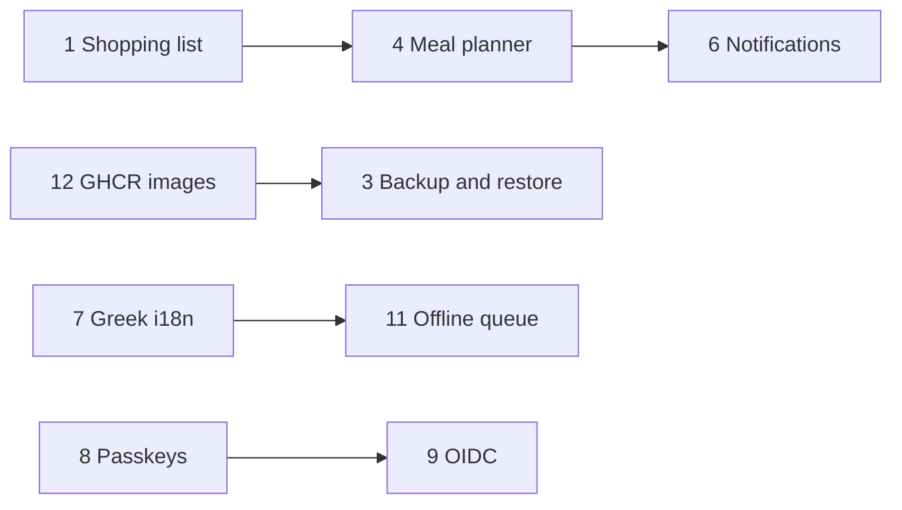

# Roadmap

The roadmap is a set of GitHub issues, not a promise. Priorities reflect what makes SVault more useful
to a household running it at home, in this order:

1. **Keep data safe.** Backups, restore and predictable upgrades come before new screens.
2. **Close loops.** Planning, shopping and stock should feed each other instead of living in separate
   apps.
3. **Respect the deployment.** One container, SQLite, no cloud account, no telemetry.
4. **Stay boring.** Prefer the standard library and small, auditable dependencies.
5. **Work on a phone.** Every new screen must be usable one-handed at 360px wide.

Sizes are rough: **S** a day or two, **M** about a week, **L** one to two weeks of focused work.

## v1.1 - Everyday convenience

The next milestone focuses on the weekly routine: getting data in, planning meals, buying what is
missing, and deploying updates without copying image tarballs.

| Issue | Area | Size | Why it matters |
| --- | --- | --- | --- |
| [#12 Publish multi-arch images to GHCR](https://github.com/AtaKon/svault/issues/12) | Deployment | M | Removes the manual `docker save`/`load` step and makes NAS updates one pull. |
| [#10 CSV import for inventory](https://github.com/AtaKon/svault/issues/10) | Inventory | M | Lets spreadsheet users migrate without re-entering everything. Export already exists. |
| [#1 Shopping list from recipes and low stock](https://github.com/AtaKon/svault/issues/1) | Recipes, Inventory | L | Turns "what is missing" into a list you can actually take to the shop. |
| [#6 Deliver reminders to ntfy, Apprise or a webhook](https://github.com/AtaKon/svault/issues/6) | Deployment | M | Browser notifications only work with a tab open; a family needs reminders on a phone. |
| [#4 Weekly meal planner](https://github.com/AtaKon/svault/issues/4) | Recipes, UX | L | Connects recipes to the shopping list. Depends on #1 for the full loop. |
| [#16 Transfer house ownership](https://github.com/AtaKon/svault/issues/16) | Security, UX | S | Closes an access-control gap: the owner currently cannot hand the house to anyone else. |

## v1.2 - Power user

Once the weekly loop works, the next milestone hardens operations and serves heavier use: datasets,
identity, localization and offline use.

| Issue | Area | Size | Why it matters |
| --- | --- | --- | --- |
| [#3 One-click backup and restore](https://github.com/AtaKon/svault/issues/3) | Deployment, Security | L | The biggest operational gap: backups should not require shell access. |
| [#5 Import YOLO/COCO datasets and review labels](https://github.com/AtaKon/svault/issues/5) | Photos | L | Datasets can be exported but not imported, which blocks existing projects. |
| [#7 Localize the UI (Greek first)](https://github.com/AtaKon/svault/issues/7) | UX | L | English-only UI and hard-coded number/date formatting is a practical blocker. |
| [#11 Offline stock queue](https://github.com/AtaKon/svault/issues/11) | PWA | L | Basements, garages and cabins have poor signal; queued stock changes fix that. |
| [#8 Passkey (WebAuthn) sign-in](https://github.com/AtaKon/svault/issues/8) | Security | M | Phishing-resistant login and an escape hatch from password-only accounts. |
| [#9 OIDC single sign-on](https://github.com/AtaKon/svault/issues/9) | Security | L | Households already running Authentik/Keycloak should not need another password. |

## Dependencies

This is a soft ordering. Anything can be picked up early if it is well scoped; the issue threads are
the place to coordinate.

## Recently shipped

The current codebase also includes:

- multi-house tenancy with owner/admin/member/viewer roles and link invites,
- items with per-house attributes, categories, places, tags and barcodes,
- batch-based stock with FIFO consumption, waste, moves, counts and a movement ledger,
- unit conversion and per-unit price history,
- low-stock and expiry reminders,
- barcode scanning with OpenFoodFacts fallback,
- receipt scanning that adds a whole basket to stock, with shops and purchase provenance recorded on
  every batch and movement,
- recipe OCR in the browser, AI or local parsing, and recipe improvement,
- AI or local food ideas from current stock,
- photo folders, bounding boxes, train/val/test splits and YOLO/COCO export,
- an installable PWA with a cached shell,
- Docker and TrueNAS/Dockge deployment guides.

## Not planned

These come up often but are deliberate non-goals for now:

| Idea | Why not |
| --- | --- |
| Cloud sync / hosted SaaS | SVault is local-first and single-tenant. Sync would add accounts, encryption and a service to run. |
| Native iOS/Android apps | The PWA installs from the browser and keeps one codebase. |
| Model training inside SVault | The app manages datasets; training belongs in a notebook or a dedicated tool. |
| External database (Postgres/MySQL) | SQLite is a feature for this deployment size. A change would need a real migration story. |
| Telemetry and analytics | Nothing leaves the server unless you configure AI or look up a barcode. |
| Stable public API guarantees | The API serves the bundled client. A versioned API would need a compatibility promise and tests. |
| SAML / SCIM | OIDC covers self-hosted identity providers; enterprise provisioning is out of scope. |

## How to influence the roadmap

- **Comment on an issue** with your use case. Concrete workflows are more useful than a +1.
- **Open a feature request** using the template, including what you do today and what would change.
- **Pick a `good first issue`** if you want to contribute code. #10 and #12 are the current entry
  points.
- **Report a bug** separately; bugs jump the queue.

Every feature issue uses the same definition of done:

- [ ] The behaviour is described in the issue, including what is out of scope.
- [ ] The API is validated and documented in [docs/api.md](api.md).
- [ ] Permissions follow the existing role model.
- [ ] Tests cover the happy path and the failure that matters.
- [ ] The UI works at 360px and in dark mode.
- [ ] The change is reflected in the user guide and changelog.
