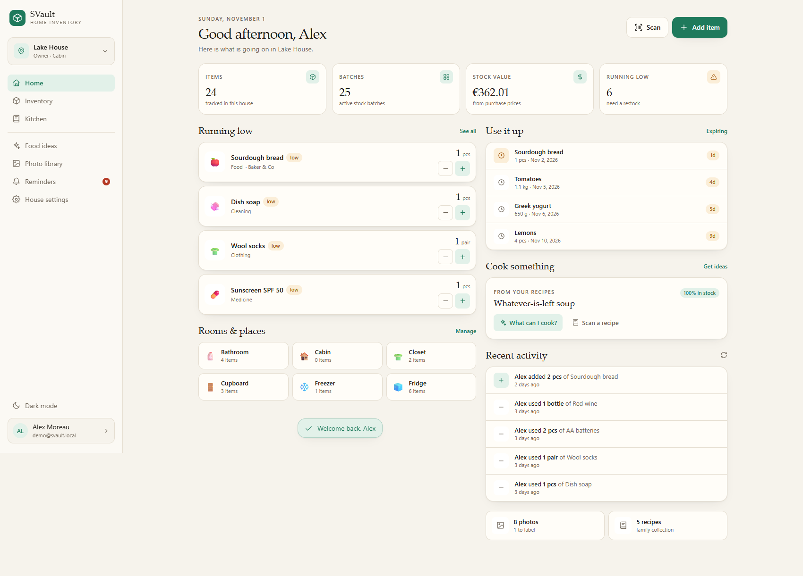
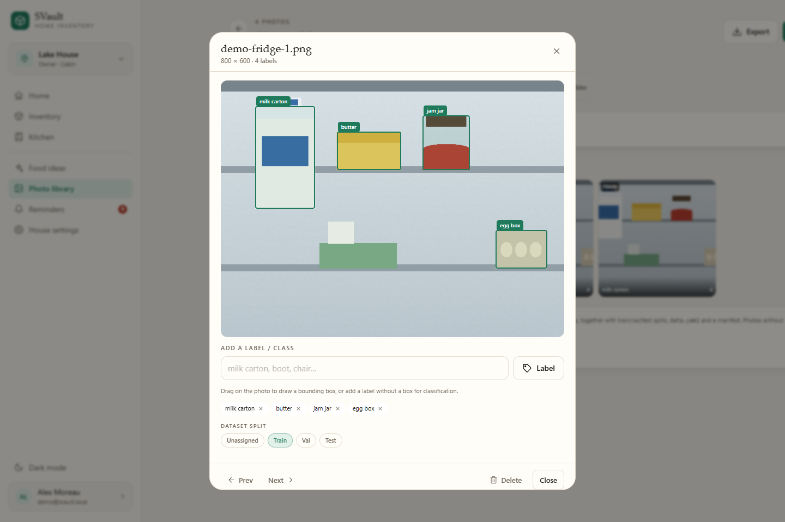

# User guide

This guide walks through SVault from the first login to a populated vault. It assumes SVault is
already running; if not, follow the [quick start](../README.md#quick-start-docker) or the
[deployment guide](deployment.md).



## 1. First login

Open the URL printed by your deployment (for example `http://localhost:8080`).

1. Create an account with your name, email and a password of at least 8 characters. You can pick a
   username (or let SVault derive one from your email) and sign in with either the username or the
   email from then on.
2. The first account becomes the instance administrator and the **owner** of a new house named
   after you.
3. Houses come with sensible default places (Kitchen, Pantry, Fridge, Freezer...), categories and a
   few attributes. Rename or delete anything you do not need.

If the deployment was started with `SEED_DEMO=true`, you can sign in with the demo accounts instead:

```
demo@svault.local / demo1234
sofia@svault.local / demo1234
```

Demo data is only created when the database is empty. It never overwrites real data.

## 2. Houses, people and roles

A **house** is the unit of isolation. Every item, stock movement, recipe and photo belongs to
exactly one house. A user can belong to several houses and switch between them from the sidebar or
the **More** page.

Open **More -> House settings -> Members** to invite people.

| Role | Can do |
| --- | --- |
| **Viewer** | Read everything in the house, mark reminders as read, download exports |
| **Member** | Everything a viewer can, plus create/edit items, change stock, manage places and categories, create recipes and ideas, label photos |
| **Admin** | Everything a member can, plus house settings, attributes, AI and reminder settings, invites, member management, deleting places/categories |
| **Owner** | Everything an admin can, plus delete the house and manage other admins |

Notes:

- A house has one owner. Ownership transfer is not implemented yet
  ([#16](https://github.com/AtaKon/svault/issues/16)); until it lands, the owner cannot be demoted or
  removed, and cannot leave without deleting the house.
- Invites are links, not emails. Create an invite, copy `/join/<code>` and send it yourself. If you
  enter an email address, only that address can accept it.
- Revoked invite links stop working immediately. Invites do not expire automatically; revoke them in
  **Settings -> Members** when they are no longer needed.
- There is no password-reset email. The owner can reset a password from the database or you can
  re-seed a fresh volume. This is a deliberate self-hosted trade-off.

## 3. Inventory concepts

SVault separates four ideas that most inventory apps mix together:

- **Item** - the product or thing ("Olive oil", "AA batteries"). It has a name, category, base unit,
  reorder point, target stock, optional attributes, tags and barcodes.
- **Batch (lot)** - one purchase of that item. Each batch has its own quantity, location, purchase
  date, expiry date and unit price. Two bottles of oil bought on different days are two batches.
- **Movement** - an immutable ledger entry describing a change: in, out, waste, count (adjust) or
  move. Movements store the balance after the change.
- **Place** - where a batch physically is (Pantry, Garage shelf, Cabin). Places can be nested.

The quantity shown on an item is the sum of its batches. Value is the sum of
`quantity x unit price` where a price is known.

### Units

Units are grouped into mass, volume and countable units:

| Family | Units |
| --- | --- |
| Mass | `mg`, `g`, `kg`, `oz`, `lb` |
| Volume | `ml`, `cl`, `dl`, `l`, `tsp`, `tbsp`, `cup`, `floz`, `pint`, `qt` |
| Count | `pcs`, `pc`, `pack`, `box`, `bottle`, `can`, `jar`, `bag`, `roll`, `pair`, `set`, `dozen` |

An item has one **base unit**. Stock can be entered in any compatible unit and is converted before it
is stored. For example, adding `500 ml` to an item whose base unit is `l` stores `0.5 l`. You cannot
convert mass to volume; SVault rejects it instead of guessing a density.

Count aliases (`pack`, `box`...) are treated as one piece because their real contents are unknown.
If the pack size matters, create the item in `g`, `ml` or `pcs` and enter the true amount.

### Prices

Record a unit price whenever you add stock. SVault normalises it to the item's base unit:

- `500 ml` for 0.80 EUR becomes `1.60 EUR/l` on the price chart.
- The item page shows the latest, average, minimum and maximum per-unit price and the change since
  the previous purchase.
- Use the **All shops** selector on the price chart to compare one shop's prices, then switch back to
  all shops. Every purchase is listed underneath with date, shop, quantity, entered price and
  normalised per-unit price.
- Price history is derived from purchase movements. Editing or deleting movements later can change
  the chart.

## 4. Everyday inventory tasks

### Add an item

1. **Inventory -> New item** (or the `+` button).
2. Enter a name, choose a category and base unit.
3. Optionally set a reorder point, target stock, brand, attributes, tags and barcodes.
4. You can add an initial batch at the same time: quantity, price, place, purchase date, shop and expiry.
5. Add a photo to make the item easy to recognise. Click or tap a photo in the inventory list or on the
   item page to open it full-size; press Escape, tap outside the image or use the close button to return.

Attributes are defined per house in **Settings -> Attributes**. Supported types are text, number,
select, date, boolean and URL.

### Add a receipt and record the shop

1. **Inventory -> Receipt** (or **More -> Receipts & shops -> Scan receipt**).
2. Take a photo of the paper receipt or upload one from your photo library. OCR runs in the browser;
   correct any lines it misread before pressing **Read receipt**.
3. The shop printed on the receipt is detected automatically and matched to your existing shops. Known
   layouts are parsed with a shop-specific template — Lidl Greece and Sklavenitis Greece are built in,
   including weights, quantity lines, barcodes and store discounts. The receipt header shows whether it
   was read by **AI**, a **template** or the **local** parser. Check the shop, purchase date, total,
   **net**, **tax/VAT** and **money saved**. When the receipt prints VAT rates they are read as a split;
   you can correct the total, net and tax before importing. Every product line can be excluded, renamed,
   given a quantity, unit and price, or pinned to an existing item. Lines without a match create new items.
4. Press **Add lines to inventory**. Each line becomes a stock batch with the price, purchase date and
   shop attached. The receipt, its photo and the line details stay under **Receipts**.

Correcting a line — for example pinning `ΑΛΕΞ.ΛΕΥΚ.ΑΣΠ.1KG` to your “Flour” item — teaches SVault that
shop's name for next time. The original receipt name is stored with the line, and the alias is reused on
future receipts from the same shop. Lines that are only carrier bags or packaging fees are skipped by
the Lidl template; Sklavenitis keeps the printed barcodes, so a line can match an item by barcode.
Separate discount lines are never imported as products: their amounts are applied to the relevant
product where possible and always summed into the receipt's **money saved** total.

The **Insights** tab adds up receipts: total spend, net and tax, average basket, spending by month,
spending by shop, the VAT split and spending by item category. Pick 3, 6, 12 months or all time. Tax
figures use what was recorded on each receipt; net falls back to total minus tax, or to total when no
tax was entered.

The **Shops** tab lists the places you buy from. A shop is created automatically the first time a
receipt uses a new name. You can also pick one under **Where from** when adding stock or an initial
batch, and it is shown on the item's batches and history.

**Suggested** opens a catalogue of common Greek supermarkets, delis, kiosks, markets and online shops.
Adding one creates a normal house shop; missing chains and local shops can still be added by hand. The
catalogue is keyed by country, so more countries can be added later.

### Receipt templates

**Purchases -> Templates** lists the built-in Lidl Greece and Sklavenitis Greece templates and any custom
templates. Templates control how a shop's layout is parsed: where products start and end, the product
line pattern, quantity and weight follow-ups, discount lines, receipt-level savings lines, the totals
line and the VAT table.

- **Clone** the Lidl or Sklavenitis template as a starting point, or create a new one.
- Detection keywords decide which template is used. Each matching keyword raises confidence; the
  template is only chosen above its threshold. Unknown layouts fall back to the generic parser or AI.
- Paste a real receipt's OCR text and press **Test rules** to see parsed products, totals, tax split and
  discounts before saving.
- Patterns are regular expressions with named groups such as `name`, `total`, `rate`, `qty`,
  `unitPrice`, `unit`, `amount`, `net`, `tax` and `gross`.
- Templates are versioned and can be deactivated without deleting them.

### Product names and aliases

Receipt names are often shortened or shop-specific. SVault handles this in two ways:

- Every correction or pinned line is remembered as a vendor-specific alias (`ΑΛΕΞ.ΛΕΥΚ.ΑΣΠ.1KG` →
  your flour item). The scan screen also suggests products using existing aliases and a local
  similarity search, showing a confidence percentage.
- On an item page, **Receipt names** lists all aliases for that item. You can add a name manually and
  choose “Any shop” or a specific shop, or remove names that are wrong. One item can have many aliases.
- When a line resolves to an OpenFoodFacts product, the pair is also stored in a **shared product
  catalogue**. The catalogue is instance-wide, ships with bundled mappings, and can be exported,
  imported or synced by an instance admin under **Settings → Data → Product catalogue**. Local
  corrections always win over bundled or imported data.

### Change stock

Open an item and use the stock dialog. There are five actions:

| Action | What it does |
| --- | --- |
| **Add** | Creates a new batch. Optionally records unit price, place, shop, purchase date and expiry. |
| **Remove** | Consumes stock FIFO: soonest expiry first, then oldest purchase. |
| **Waste** | Same as remove, but records a `waste` movement so waste is visible separately. |
| **Set** | Absolute count. SVault records the difference as an adjustment; use this after a physical count. |
| **Move** | Transfers quantity between two places without changing the total. |

Removing more than is available is rejected. Wasting or removing with a `locationId` restricts FIFO to
that place.

### Barcodes and scanning

- Each item can hold several barcodes, unique per house.
- **Scan** opens the rear camera (ZXing). On plain HTTP or a browser without camera support, type the
  code instead.
- A known code opens the matching item.
- An unknown code is looked up on OpenFoodFacts. If found, the name, brand, description, quantity and
  image pre-fill the new-item form. The lookup is cached for 30 days and times out after six seconds,
  so offline use still works.

### OpenFoodFacts product links

- The item page has an **OpenFoodFacts** card. If the item is not linked, press **Link product** and
  search by name or paste a barcode. You can also link from a receipt line while scanning.
- Linking fills only empty fields: description, brand, image and a matching house category. It also
  attaches the product code as an item barcode. Values you already set are never overwritten.
- **Fill empty fields** re-applies the product after you have edited the item. **Change** picks another
  product; **Unlink** removes the link but keeps everything already filled.
- The card shows the product image, Nutri-Score, NOVA group, labels, allergens and ingredients. The
  complete OpenFoodFacts payload stays cached on the server.
- Linking also stores the nutrition panel from OpenFoodFacts: energy (kcal and kJ), fat, saturates,
  carbohydrate, sugars, fibre, protein, salt and sodium, normalised per 100 g or 100 ml. Existing
  nutrition values are never overwritten by a later sync.
- Nutrition can also be entered by hand in the item editor, for products OpenFoodFacts does not cover.
  Values are kept per 100 g or 100 ml, with an optional serving size and serving weight. The serving
  weight lets recipes estimate count-based ingredients such as eggs or yogurt cups.
- Receipt lines show an **OpenFoodFacts** badge when a cached product or shared mapping matched. Use
  **Find OpenFoodFacts** to confirm or change a line before importing; the chosen code is sent with the
  line.
- You can also scan from an item page to attach a code to an existing item.

### Low stock and expiry

- An item is low when its quantity is at or below its reorder point. Set the reorder point to `0` to
  disable the reminder for that item.
- Expiry reminders cover batches with quantity left whose expiry is within the configured number of
  days (7 by default). Expired batches are flagged separately.
- Reminders are recalculated after every stock change and by a scan at boot and every 30 minutes.
- **Reminders** shows the active list across every house you belong to. Being added to a new house
  creates a notification for you, even before you switch to it.
- Press the bell icon to enable browser notifications; they only
  arrive while SVault is open in a tab. See [roadmap](roadmap.md) for external delivery.

### Search, filters and bulk actions

The inventory page supports free-text search, category and place filters, low-stock and expiring
filters, sorting by value, and inline `+/-` one-unit adjustments. The dashboard repeats the most
useful slices: running low, use-it-up (expiring), places and recent activity.

## 5. Recipes

### Add a recipe manually

**Kitchen -> New recipe**. Ingredients have a name, optional quantity and unit, an optional link to an
inventory item, and an optional/required flag. Steps are free text; a timer can be attached to a step.

### Scan a handwritten recipe

1. **Kitchen -> Scan recipe**.
2. Photograph the card. The image is compressed in the browser and uploaded as the source image.
3. Tesseract OCR runs **in the browser** using assets served from `/tesseract`, with **English and
   Greek** language data. The image and the OCR text are not sent to an AI provider unless a vision
   model is configured.
4. Correct the recognised text if needed and press **Digitise**.
5. The server cleans the text:
   - with an AI provider, it returns structured ingredients and steps and notes any inferences;
   - without one, a local parser handles sections, quantities, fractions, ranges and timers.
6. Review the draft, edit anything, then save.

The recipe records which path was used (AI or local) and keeps the OCR text for reference.

### Improve with AI

Open a saved recipe and press **Improve with AI**. The action fills missing quantities, times and
temperatures and rewrites unclear steps, noting what changed. It requires a configured provider and
member access.

### Calories per recipe and portion

Recipes estimate nutrition from their ingredients. Any ingredient whose name matches an inventory item
with a nutrition panel is scaled to the quantity and unit in the recipe. The recipe page shows the
whole-recipe total and, when servings are set, the calories and macros per portion. Recipe cards show
a `kcal / portion` badge.

The estimate is deliberately transparent: it reports how many ingredients contributed. Add nutrition
to the remaining items, or set a serving weight on count-based products, to improve the number.

### Cook from what you have

Every recipe shows ingredient availability against current stock. Matching is deliberately loose:
"eggs" matches "Free-range eggs". Missing ingredients are listed with quantities, which is the input
for the planned shopping list.

### Food ideas

**Food ideas** sends your prompt, current stock and saved recipes to the AI, or to the local matcher
when no provider is configured. Local suggestions rank saved recipes by ingredient coverage and add
inventory-only ideas. Saving an idea creates a normal recipe tagged `ai` and `idea`.

Nothing about stock, barcodes, prices or reminders is sent to an AI provider.

## 6. Photo library and vision datasets



### Folders and uploads

- Photos live in **collections** (folders) per house.
- Upload up to 30 images at once, up to `MAX_UPLOAD_MB` each (20 MB by default).
- Supported formats depend on the browser, but uploads are stored unchanged. JPEG, PNG, WebP, GIF,
  AVIF, HEIC/HEIF, BMP and TIFF are accepted by the server.

### Labels and boxes

- Drag on a photo to draw a bounding box, then type or pick a label. Boxes are stored as fractions of
  the image size, so they survive resizing.
- A label without a box works as a classification tag.
- Labels are shared across the house, which keeps class names consistent.

### Splits

Each photo has a split: `train`, `val`, `test` or `unassigned`. Set it while uploading or later in the
photo detail. Splits are preserved in exports.

### Export a dataset

**Photos -> Export dataset** produces a zip:

```
images/<split>/<file>
labels/<split>/<file>.txt
classes.txt
data.yaml
manifest.csv
annotations.json        (COCO format only)
```

- YOLO boxes are normalised (`class x_center y_center width height`).
- COCO boxes are absolute pixel coordinates with categories.
- Photos without boxes still appear in `manifest.csv` as classification samples.

## 7. Settings

**House settings** has eight tabs:

| Tab | Purpose |
| --- | --- |
| General | House name, kind, address, currency, and leaving the house |
| Places | Add, rename, nest and delete locations |
| Categories | Same for categories, with icons |
| Attributes | Custom fields available on items (admin only) |
| Members | Invites, roles and removal |
| AI | Provider preset, base URL, models, key, connection test |
| Reminders | Low-stock toggle and expiry warning window |
| Data | Inventory CSV export, dataset export, data location, house deletion |

**Profile** (under More) holds your name, email, password, theme and install prompt. Phones and
desktops can install SVault as a PWA from the browser menu.

## 8. Connecting AI

1. Open **Settings -> AI** as owner or admin.
2. Pick a preset or fill the fields manually:
   - **OpenAI** - `https://api.openai.com/v1`, model `gpt-4o-mini`
   - **OpenRouter** - `https://openrouter.ai/api/v1`
   - **Ollama** - `http://host.docker.internal:11434/v1` (Docker Desktop) or your host IP
   - **LM Studio** - `http://host.docker.internal:1234/v1`
3. Save, then press **Test saved connection**.

A key saved in house settings wins over the server environment. The API never returns the stored key;
the UI shows a `***` placeholder. Without a key everything still works, with local OCR and parsing and
local meal suggestions.

If you use a vision model, SVault can read the recipe photo when OCR finds no text. Without one, it
sends only the edited OCR text. A text-only local model never receives images.

## 9. Data, backup and moving house

- Everything is stored under `DATA_DIR`: `svault.db` (SQLite, WAL mode) plus `uploads/`.
- **Settings -> Data -> Inventory CSV** downloads the current inventory as CSV. It uses the API's
  1000-item page, so very large vaults should use the API or database directly.
- Dataset exports are generated on demand.
- For a full backup, copy the whole `DATA_DIR` (or the `svault-data` Docker volume). Stop the
  container first for the most consistent SQLite copy, or use `sqlite3 svault.db ".backup ..."`.
- To move to another server, copy `DATA_DIR` to the new host and start the same image with the same
  `DATA_DIR`.

## 10. Troubleshooting

| Symptom | Likely cause / fix |
| --- | --- |
| Login succeeds but the next request is signed out | `COOKIE_SECURE=true` while browsing over plain HTTP. Set it to `false` or use HTTPS. |
| Camera scanner says unavailable | Browsers require HTTPS or localhost. Use a TLS reverse proxy; manual entry still works. |
| 413 when uploading photos | Reverse proxy body limit. Raise `client_max_body_size` (NPM) or the equivalent. |
| AI test times out | Proxy timeout or wrong base URL. For Ollama on Linux use the host IP, not `host.docker.internal`. |
| AI returns "no provider configured" | No key in house settings and none in the environment. |
| Reminder never appears | Reorder point is `0`, low-stock reminders are disabled, or the quantity is above the threshold. |
| Photo labels look shifted after cropping | Boxes are relative to the original uploaded image; re-upload rather than crop outside SVault. |
| Data disappeared after recreating the stack | The volume or host path changed. Check `DATA_DIR` and the compose volume mapping. |

More deployment-specific fixes are in [deployment.md](deployment.md) and the
[TrueNAS guide](../deploy/dockge/README.md#troubleshooting).
